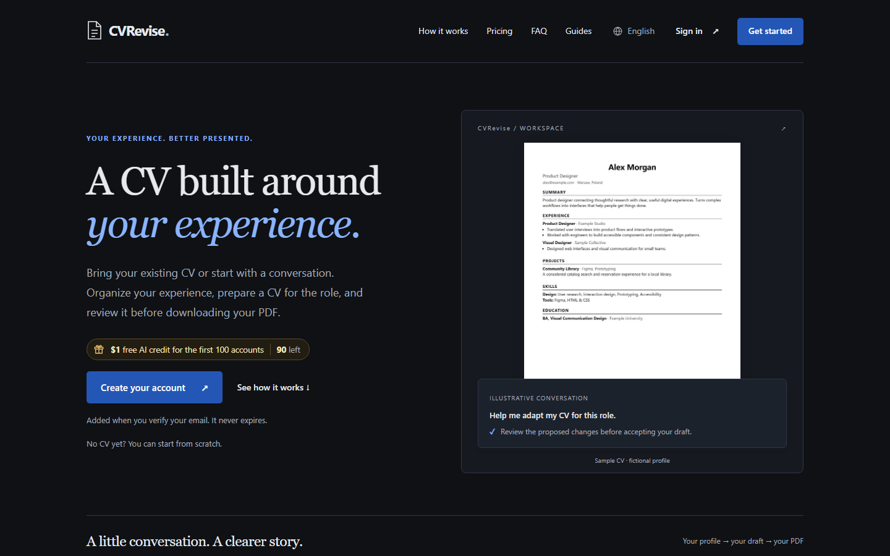
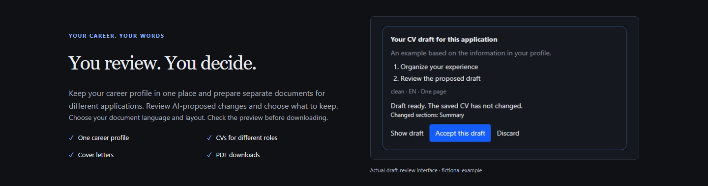
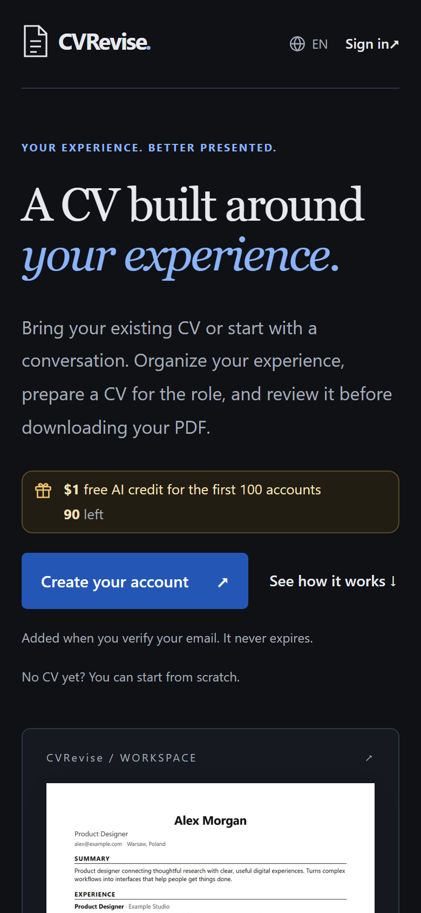
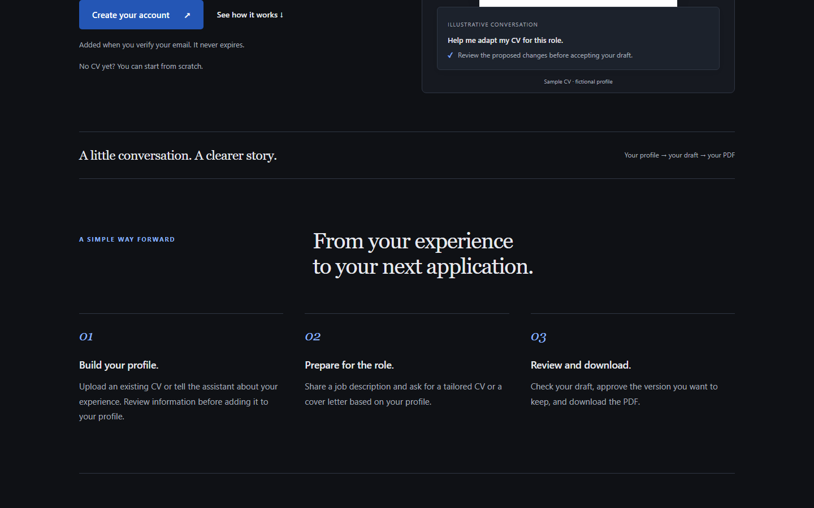

# CVRevise

**A CV built around your experience.**

CVRevise is an AI-assisted CV and cover letter workspace. Bring the CV you already
have, or start from a conversation. You keep one career profile, prepare a version
for each job posting, and review every change before you download the PDF.

Live: **https://cvrevise.com**

## What it does

- **One profile, many CVs.** Your experience is stored once, as structured data, not
  as a document you retype for every application.
- **A CV for the posting in front of you.** Paste a job description and the assistant
  drafts a CV from the facts in your profile, putting your most relevant experience
  first. Cover letters come from the same profile and the same posting.
- **Jev score.** A check of how well your CV covers the requirements of a posting and
  which ones are missing. It measures fit, not your chances of being hired.
- **You review, you decide.** AI-proposed changes arrive as a list you accept or
  discard. The saved CV does not change until you say so.
- **Your language.** CVs, cover letters and the assistant work in English, Turkish,
  German, Polish and 24 more languages.
- **PDF download** in several templates, with the preview matching the file.
- **Pay as you go.** No subscription to keep alive between job hunts.

## Screenshots

| Review flow | Mobile |
|---|---|
|  |  |

## How it works

## Why this repository exists

The application source is private. This repository is the public front door: what
the product is, what it looks like, and where to report a bug or ask a question.
There is no code to install here and nothing here builds, deploys, or connects to
anything.

Ideas, feedback and bug reports are welcome in
[Issues](https://github.com/UgurInanc12/cvrevise/issues). Please do not paste a real
CV into an issue; use a redacted example.

## About the `.env` file in this repo

[`.env`](.env) contains API keys. Every one of them is fake, and every one of them is
shaped exactly like the real thing, because that is the joke: crawlers and secret
scanners crawl public repositories looking for free keys, so the keys they find here
are worthless. The file authenticates nothing. Real configuration never leaves the
team's machines.

If you are a human who found a key in this repo: no, it does not work. If you are a
scanner: welcome, enjoy the documentation.

## Built on

The resume engine started from [Resume-Matcher](https://github.com/srbhr/Resume-Matcher)
(Apache 2.0). Its prompt-injection sanitizing, truthfulness rules and diff
verification are still in place; CVRevise's profile, scoring, review flow and
interface are built on top.

## License

Not open source. Text, screenshots and the CVRevise name are © CVRevise, all rights
reserved. The upstream Resume-Matcher components remain under Apache 2.0.

---

Questions: [Issues](https://github.com/UgurInanc12/cvrevise/issues) ·
Product: [cvrevise.com](https://cvrevise.com)
